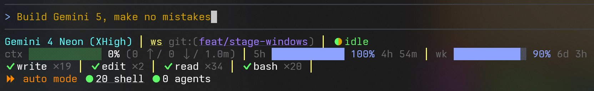

# antigravity-hud

[](https://www.npmjs.com/package/antigravity-hud)
[](https://www.npmjs.com/package/antigravity-hud)
[](LICENSE)

> A 4-line statusline HUD for the [Antigravity CLI](https://github.com/google-antigravity/antigravity-cli).



## The backstory

Whilst building SynCloudOS I burned through my entire [Claude Code](https://claude.ai) and [ChatGPT Codex](https://chat.openai.com) weekly usage limits in about 48 hours. Classic. Then I rediscovered **Google Antigravity**, Google's agentic coding CLI that runs Gemini models and third-party models like Claude Opus and Sonnet through the same interface. More importantly, I realised I had been paying for it the whole time and figured I should use it at least once.

Now that Gemini 4 Neon and Argon are actually awesome, running Antigravity as a daily driver makes total sense.

Antigravity's built-in statusline is minimal, though. I wanted a HUD that shows everything at a glance: active model, context window burn, 5-hour and weekly quota bars, reset timers, git branch state, and tool activity. I also wanted a gamified interface, almost slot-machine-like (or slop-machine-like), that makes terminal sessions feel alive, à la [claude-hud](https://github.com/jarrodwatts/claude-hud).

So I built this. First as a [PowerShell script](legacy/statusline-syn.ps1), then as a zero-dependency Node.js CLI.

## What's new in 0.5.3 (since 0.4.1)

- **Gemini 4 family & Claude 5.5 support**: Full support for `Gemini 4 Neon` (including `XHigh`), `Gemini 4 Argon`, `Gemini 4 Carbon`, `Gemini 4 Hydrogen`, and `Claude Opus / Sonnet 5.5`, with 1M context window capacities, model pricing, and compact `tiny` layout labels (`(XH)`, `(Orch)`).
- **Gemini 4 Argon Pro quota (`argon-wk`)**: Displays the dedicated `argon-wk` weekly quota bar (`gemini-argon-wtu-weekly`) when running Argon on a Google AI Pro plan, hiding the standard `5h` bar unless `gemini-5h` drops below 25%.
- **Live wall-clock quota countdowns**: Calculates remaining reset time from `reset_time` timestamps rather than static `reset_in_seconds` snapshots so countdowns tick down in real time between CLI quota refreshes.
- **Full `Shift+Tab` cycle mode support**: Renders all four Antigravity CLI `Shift+Tab` states with a media-player glyph set:
  - `⏩ auto mode on` (orange)
  - `⏵⏵ accept edits on` (light purple `#C4A7FF`)
  - `⏸ plan mode on` (teal `#2DD4BF`)
  - `⏩ bypass permissions (YOLO)` (hot pink `#FF3B8A`), `⏸ review mode on` (amber `#FFD166`), and `■ strict mode on` (icy blue `#8EA2FF`)
- **Context bar color gradient**: Context usage bar shifts from green (`<50%`) to yellow (`>=50%`), orange (`>=70%`), and red (`>=85%`) as the window fills.
- **Git ahead/behind counters & TTL cache**: Parses `[ahead N, behind M]` from a single `git status --porcelain -b` call cached with a 5s TTL (`git:(master* ↑1 ↓2)`), eliminating three synchronous `git` spawns per render tick.
- **Conversation-scoped transcript & speed caches**: Fixes stale transcript pinning across new CLI sessions, repairs `.gemini/antigravity/brain` paths to `.gemini/antigravity-cli/brain`, and scopes `tok/s` speed tracking by `conversation_id`.
- **Subagent runtimes, plan checklists, skills/MCP counters & session duration**: Line 4 surfaces active subagent role and runtime (`1 agents (Codebase Researcher 42s)`), checklist progress (`3/5 plan`), active skills (`2 skills`), MCP servers (`1 mcp`), and session duration (`14m 20s`).
- **Removed RAM polling**: Dropped RAM percentage polling and `showMemory` from the HUD and configuration wizard.

See [CHANGELOG.md](CHANGELOG.md) for the full release history.

## Features

- **Quota health bars**: 5-hour, weekly, and `argon-wk` quota bars with colour thresholds and live reset countdowns.
- **Context window meter**: Token input/output counts, capacity, and a colour-shifting progress bar.
- **Tool tallies**: Counts tool usage per category from the active session transcript (`✔ read ×5 │ ✔ edit ×2 │ ✔ bash ×3`), including `swarm`, `run_workflow`, and `mcp` calls.
- **OSC 8 terminal hyperlinks**: Clickable links for the project folder, remote GitHub branch tree, and conversation transcript log.
- **Adaptive layouts**: Scales across `normal` (`>=118` cols), `compact` (`92-117` cols), and `tiny` (`<92` cols) terminal widths.
- **Zero dependencies**: Pure Node.js built-ins (`node >= 18`) on Windows, macOS, and Linux.

## Installation

### One-command install (recommended)

Works out of the box on macOS, Linux, and Windows (Node.js 18+):

```bash
npx antigravity-hud install
```

This installs a zero-dependency standalone copy into `~/.gemini/antigravity-cli/antigravity-hud/`, backs up your existing `~/.gemini/antigravity-cli/settings.json` (keeping the 5 newest backups), and wires up `statusLine` automatically. Re-run `npx antigravity-hud@latest install` anytime to upgrade.

### Global install (adds `antigravity-hud` to your `PATH`)

If you also want to run `antigravity-hud configure`, `doctor`, or `mode` directly without `npx`:

**macOS / Linux:**
```bash
npm install -g antigravity-hud && antigravity-hud install
```

**Windows (PowerShell):**
```powershell
npm install -g antigravity-hud; antigravity-hud install
```

> Both methods create `~/.gemini/antigravity-cli/settings.json` if needed, back up existing settings (`settings.json.backup-antigravity-hud-YYYYMMDD-HHMMSS`), and configure `statusLine`.

### Verify installation

```bash
antigravity-hud doctor
```

Checks your `PATH`, prints the active configuration and permission mode, and renders a sample 4-line HUD.

### Configuration

Run the interactive configuration wizard:

```bash
antigravity-hud configure
```

Preferences are saved to `~/.gemini/antigravity-cli/antigravity-hud-config.json`:

```json
{
  "preset": "full",
  "showCost": true,
  "showSpeed": true,
  "enableLinks": true,
  "colorMode": true,
  "unicodeMode": true,
  "colors": {
    "model": "cyan",
    "project": "yellow",
    "git": "brightBlue",
    "label": "gray"
  }
}
```

#### Presets

- **`full`** (default): 4-line HUD with model, repo, git status, spinner, context bar, quotas, tool tallies, cost, speed, mode badge, subagents, plan progress, skills/MCP counts, and session duration.
- **`essential`**: 2-line HUD with model, repo, git, spinner, context bar, quotas, and cost/speed on Line 1.
- **`minimal`**: 1-line HUD with model, repo, git, spinner, and cost/speed.

### Uninstalling

```bash
antigravity-hud uninstall
```

Sets `statusLine.enabled = false` in `settings.json` and prints the command to restore your latest backup.

## Commands

### Tool Permission & Cycle Mode

Line 4 displays your active mode, reading `cycle_mode` from the live Antigravity CLI payload (`Shift+Tab` in the TUI) and falling back to `toolPermission` in `settings.json`. You can also inspect or change the persisted setting from the CLI:

- **Show current mode:**
  ```bash
  antigravity-hud mode
  ```
- **Cycle persisted modes (`review` -> `auto` -> `yolo` -> `strict`):**
  ```bash
  antigravity-hud mode next
  ```
- **Set a specific persisted mode:**
  ```bash
  antigravity-hud mode <review|auto|yolo|strict>
  ```

## Output lines explained

```
Line 1:  Gemini 4 Neon (XHigh) │ ws git:(feat/stage-windows* ↑1) │ ⠸ working
Line 2:  ctx [████░░░░] 21% (48.0k ↑ / 4.0k ↓ / 1.0m) │ 5h [█████░] 90% 4h 54m │ wk [█████░] 90% 6d 3h │ ~$0.041 │ 35.4 t/s
Line 3:  ✔ write ×19 │ ✔ edit ×2 │ ✔ read ×34 │ ✔ bash ×20 │
Line 4:  ⏵⏵ accept edits on ● 20 shell ● 1 tasks ● 1 agents (Codebase Researcher 42s) ● 3/5 plan ● 2 skills ● 1 mcp ● 14m 20s
```

| Element | Source |
|---|---|
| Model name | `model.display_name` from stdin JSON (Gemini 4 Neon/Argon/Carbon/Hydrogen, Gemini 3.x, Claude 4.6/5.5, GPT/o-series) |
| Repo | Basename of `workspace.project_dir` (OSC 8 link to local directory) |
| Branch + dirty + ahead/behind | `git status --porcelain -b` (cached 5s TTL; shows `*`, `↑N`, `↓M`; OSC 8 link to GitHub branch tree) |
| State + spinner | `agent_state` with braille spinner while active and `⚠ confirm` when tool confirmation is pending |
| Context bar | `context_window.used_percentage` with token counts; shifts green -> yellow (`>=50%`) -> orange (`>=70%`) -> red (`>=85%`) |
| Quotas | `argon-wk` on Gemini 4 Argon Pro (plus `5h` if `<25%`), or `5h` + `wk` for standard Gemini and third-party models |
| Cost & speed | `~$0.041` cache-aware API-equivalent cost estimate and `t/s` output streaming rate |
| Tool tallies | Parsed from the active conversation's `transcript.jsonl` |
| Mode badge | Live `Shift+Tab` `cycle_mode` (`⏩ auto mode on`, `⏵⏵ accept edits on`, `⏸ plan mode on`) or `settings.json` fallback (`⏩ bypass permissions (YOLO)`, `⏸ review mode on`, `■ strict mode on`) |
| Session telemetry | Shell, task, and subagent counts (with active subagent role & timer), plan checklist progress, loaded skills, MCP servers, and session duration |

### Quota colour thresholds

| Remaining | Colour |
|---|---|
| 50-100% | Purple-Blue (`#8EA2FF`) |
| 25-49% | Amber |
| 15-24% | Orange |
| 1-14% | Red |
| 0% | `⚠ Limit reached` |

## Layout modes & environment variables

| Layout | Terminal width | Bar length | Tool categories |
|---|---|---|---|
| `normal` | `>= 118` cols | 10-16 blocks | up to 6 |
| `compact` | `92-117` cols | 8 blocks | up to 5 |
| `tiny` | `< 92` cols | no bars (`%` only) | up to 4 |

| Variable | Values | Description |
|---|---|---|
| `AGY_HUD_LAYOUT` | `normal`, `compact`, `tiny` | Force a specific layout mode |
| `AGY_HUD_NO_COLOR` | `1` | Disable ANSI colour codes |
| `AGY_HUD_NO_UNICODE` | `1` | Use ASCII glyphs only |
| `AGY_HUD_NO_SPINNER` | `1` | Disable spinner animation |
| `AGY_HUD_TOOL_MAX` | `1`-`10` | Max tool categories shown on Line 3 |
| `AGY_HUD_TRANSCRIPT` | path | Override transcript JSONL path (useful for testing) |
| `AGY_HUD_LINKS` | `0`, `1` | Override OSC 8 terminal hyperlinks (enabled by default; set `0` to disable) |

## Project structure

```
antigravity-hud/
├── bin/
│   └── antigravity-hud.js    # CLI entrypoint
├── src/
│   ├── config.js             # Config loader & defaults
│   ├── git.js                # TTL-cached git status & remote URL resolver
│   ├── hyperlinks.js         # OSC 8 terminal hyperlink helpers
│   ├── quota.js              # Quota resolution, reset timers, capacities & pricing
│   ├── transcript.js         # Conversation-scoped transcript parser & speed tracker
│   └── render/
│       └── lines.js          # Adaptive 4-line ANSI HUD renderer
├── tests/
│   ├── test-hyperlinks.js
│   ├── test-integration.js
│   ├── test-parser.js
│   └── test-render.js
├── legacy/
│   └── statusline-syn.ps1    # Original PowerShell prototype
├── scripts/
│   ├── install.ps1           # Windows installer
│   └── install.sh            # macOS/Linux installer
├── docs/
│   └── payload-examples/
│       ├── statusline-last.example.json
│       └── transcript.example.jsonl
├── package.json
├── LICENSE
├── CHANGELOG.md
└── README.md
```

## Development

```bash
# Run unit & integration test suite
npm test

# Test with sample payload
cat docs/payload-examples/statusline-last.example.json | node bin/antigravity-hud.js

# Test with sample transcript
cat docs/payload-examples/statusline-last.example.json | AGY_HUD_TRANSCRIPT=docs/payload-examples/transcript.example.jsonl node bin/antigravity-hud.js
```

On Windows PowerShell:
```powershell
Get-Content docs\payload-examples\statusline-last.example.json -Raw | node bin\antigravity-hud.js
```

## License

[MIT](LICENSE).

## Credits

Designed by Kavish Krishnakumar in Manchester. Personal project, not affiliated with Syndromatic Limited. Inspired by [jarrodwatts/claude-hud](https://github.com/jarrodwatts/claude-hud).
